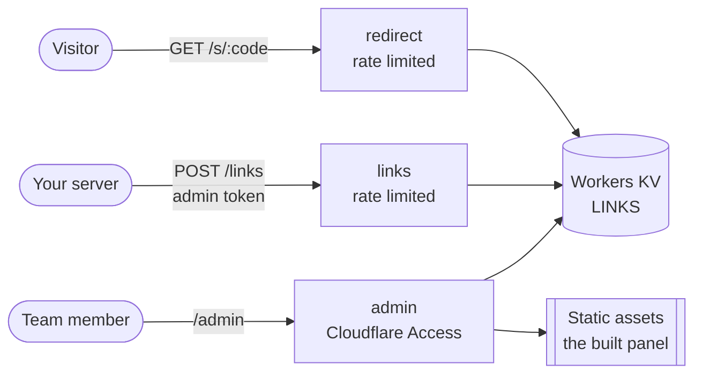

# Architecture

How Shortlinks is built and how it keeps the admin panel safe. For setup and use, see the [README](./README.md).

## Bird's-eye view

One Cloudflare Worker answers every request. It has three entry points, each with its own guard, and stores links in Workers KV: the key is the short code, the value is the full URL, and the metadata holds who created it and when.



- **Short links** (`/s/<code>`) look the code up in KV and answer with a `302` to the saved URL.
- **The API** (`POST /links`) needs the admin token, checks the URL against `ALLOWED_HOSTS`, saves it under a new random code and records `api` as the creator.
- **The admin panel** (`/admin`) is a React app plus a small JSON API under `/admin/api`. Both are behind Cloudflare Access, and links made there record the signed-in email as the creator.

Codes are 8 characters from an alphabet without look-alike characters (`0`/`O`, `1`/`I`/`l`), drawn with `crypto.getRandomValues`, discarding random bytes that would make some characters more likely than others. There is no check for a code already in use: there are about 10^14 codes, and KV caches "not found" answers, so a check could not rule out a clash anyway. The routes accept only codes in this format (`CODE_PARAM` in `src/worker/lib/links.ts`), so any other path under `/s/` is a `404` without a KV read. Both create routes refuse request bodies over 4 KiB with Hono's [`bodyLimit`](https://hono.dev/docs/middleware/builtin/body-limit). KV metadata is limited to 1024 bytes, so the URL kept there for the panel's list is cut at 800 characters; the redirect always uses the full URL stored as the value.

## Code map

This follows Cloudflare's [React + Vite + Hono template](https://github.com/cloudflare/templates/tree/main/vite-react-template).

```
admin/index.html     The admin panel's page, served at /admin/
src/react-app/       The admin panel: React components (components/ui/ holds the shadcn/ui ones, trimmed to what the panel uses), the theme provider, API calls, lib/utils.ts re-exporting the `cn` class helper where shadcn/ui components import it, and index.css with Tailwind, shadcn's open and closed variants and the theme colours
components.json      shadcn/ui settings: `pnpm dlx shadcn@latest add <component>` writes into src/react-app/components/ui/
src/worker/          The Worker (Hono): index.ts wires the routes in routes/ to the helpers in lib/
src/shared/          Types and the short-link address helper, used by both
test/                Tests that run inside the Workers runtime, and their TypeScript settings
vitest.config.ts     Test settings: the Workers runtime and fixed test values for the admin token and Access
wrangler.jsonc       Bindings, variables and static assets settings
.dev.vars.example    Template for the local `.dev.vars`, and the Worker secrets Deploy to Cloudflare asks for
eslint.config.js     ESLint rules: TypeScript, React hooks and TSDoc
docs/screenshots/    The admin panel screenshots shown in the README
.github/workflows/ci.yml  CI: audit, generated types, `pnpm run check` and the tests
```

## Admin panel security

- **Cloudflare Access signs people in.** The panel shows the email of the person signed in, for example `admin@ianmenethil.com`, and records it against each link they create. It comes from the Access sign-in, not from your Cloudflare account.
- **The Worker checks every admin request itself**, so the panel cannot be reached around Access, for example on the `workers.dev` address. It accepts Cloudflare's [`ctx.access`](https://developers.cloudflare.com/workers/configuration/cloudflare-access/) when the runtime provides it (local development does; a deployed Worker with static assets does not) or verifies the [Access token](https://developers.cloudflare.com/cloudflare-one/access-controls/applications/http-apps/authorization-cookie/validating-json/) in `Cf-Access-Jwt-Assertion` against your team's public keys, which Cloudflare caches for five minutes. The token must be for `ACCESS_AUD`, issued by `ACCESS_TEAM_DOMAIN`, signed with RS256 by a key in that set, and carry an expiry (`exp`); Hono checks `exp` only when a token has one, so the Worker refuses tokens without it.
- **The panel's own files are behind the same check.** The panel is built into `/admin/assets/`, and `run_worker_first` in `wrangler.jsonc` sends every `/admin` request to the Worker first. The Worker hands the page and files to the static assets only once the Access check passes.
- **The admin API answers only the panel.** It sends no CORS headers, so browsers stop other sites from reading it or sending it JSON. Hono's [`csrf`](https://hono.dev/docs/middleware/builtin/csrf) middleware refuses form-style requests from other sites. Its answers carry `Cache-Control: no-store`.
- **The panel's pages carry security headers** from Hono's [`secureHeaders`](https://hono.dev/docs/middleware/builtin/secure-headers). The Content Security Policy has `script-src 'self'`, so only the panel's own bundled script runs, and `style-src 'self' 'unsafe-inline'`, because shadcn's toast (Sonner) and dialog (Radix) add `<style>` tags and style attributes while the page runs. It also has `object-src 'none'` and `frame-ancestors 'none'`, with `X-Frame-Options: DENY` to match. `Strict-Transport-Security` is set for this site only (`max-age=15552000`, without `includeSubDomains`), so deploying the template on a domain does not force HTTPS on its other subdomains.

The public routes' guards (allowed hosts, rate limits) are described in the README's feature list. To report a security problem, see [SECURITY.md](./SECURITY.md).

## Build and type checking

Vite builds the panel and the Worker together through the [Cloudflare Vite plugin](https://developers.cloudflare.com/workers/vite-plugin/). The TypeScript settings are split by where the code runs, so browser-only and Worker-only features cannot leak into each other: `tsconfig.app.json` (the panel), `tsconfig.worker.json` (the Worker), `tsconfig.node.json` (the Vite and Vitest config files) and `test/tsconfig.json` (the tests).

TypeScript 7 does the type check (`tsc`). ESLint's TypeScript support does not run on TypeScript 7 yet, so `package.json` also installs TypeScript 6 under the name `typescript` for it, as the [TypeScript 7.0 announcement](https://devblogs.microsoft.com/typescript/announcing-typescript-7-0/) describes; TypeScript 7 is installed as `@typescript/native`.
