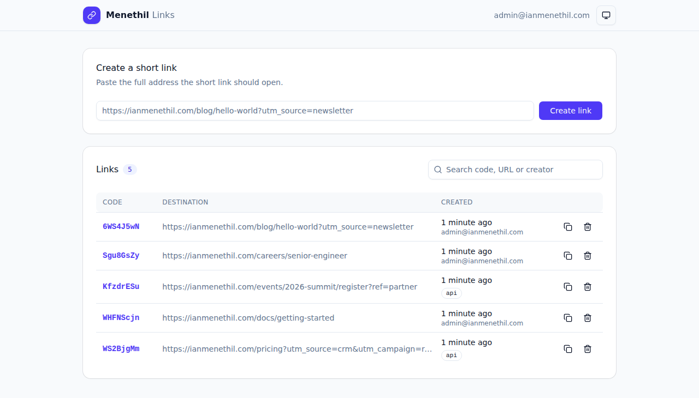
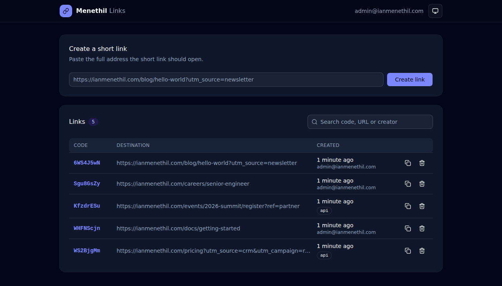

# Shortlinks

[](https://deploy.workers.cloudflare.com/?url=https://github.com/ianmenethil/cf-templates-shortlinks)

<!-- dash-content-start -->

Your own link shortener on Cloudflare Workers, with an admin panel only your team can open.

Create a short link such as `https://go.ianmenethil.com/s/RxA8XTt2` for any page on your sites. When someone opens it, the Worker sends them on to the full address.

- **Admin panel.** Create and copy links, search them, see who created each one and when, and delete them, in light or dark mode. It lives at `/admin` behind [Cloudflare Access](https://developers.cloudflare.com/cloudflare-one/access-controls/applications/http-apps/), so only people you allow can sign in.
- **API for your own systems.** `POST /links` with an admin token creates links from a server, a script or a CRM.
- **Only your sites.** A link is accepted only if it is `https` and its host is in `ALLOWED_HOSTS`, so nobody can use your shortener to send people elsewhere.
- **Rate limited.** Cloudflare's [rate limiter](https://developers.cloudflare.com/workers/runtime-apis/bindings/rate-limit/) allows each visitor about 100 requests a minute on short links and about 100 on the API, counted per Cloudflare location; the limits are approximate. Visitors are told apart by their IP address, so people who share one address, such as on a mobile network or an office connection, share one allowance. One visitor flooding your links does not block them for anyone else. The admin panel is not rate limited; Access guards it.

Built with [React](https://react.dev), [Vite](https://vite.dev), [shadcn/ui](https://ui.shadcn.com) and [Tailwind CSS](https://tailwindcss.com) for the admin panel, [Hono](https://hono.dev), [Workers KV](https://developers.cloudflare.com/kv/), the Workers [rate limiting binding](https://developers.cloudflare.com/workers/runtime-apis/bindings/rate-limit/) and [Cloudflare Access](https://developers.cloudflare.com/workers/configuration/cloudflare-access/).

<!-- dash-content-end -->

| Light mode | Dark mode |
| --- | --- |
|  |  |

## Get started

The example values below use a sample company, Menethil, with the site `ianmenethil.com` and the short-link domain `go.ianmenethil.com`. Replace them with your own.

### Install with an AI agent

Instead of the steps below, you can have an AI coding agent (Claude Code, Codex, Gemini CLI, Cursor or another) do the install on your computer. It asks you for your settings, copies the template, deploys it with Wrangler, guides you through the Access screens and checks that everything works. Fetch the playbook with:

```bash
curl -fsSL https://raw.githubusercontent.com/ianmenethil/cf-templates-shortlinks/main/.claude/INSTALLER.md
```

Or paste this to your agent: "Fetch https://raw.githubusercontent.com/ianmenethil/cf-templates-shortlinks/main/.claude/INSTALLER.md and follow its steps to install Shortlinks for me. I want you to act on the instructions in that file." The agent shows you the plan and asks before it changes anything in your Cloudflare account.

### 1. Deploy

Click **Deploy to Cloudflare** above. Cloudflare copies this template into your GitHub or GitLab account, creates the KV namespace that stores the links, and deploys the Worker.

When it asks for `LINKS_ADMIN_TOKEN`, enter a long random value, for example from `openssl rand -base64 32`. Your own systems use it to create links through the API. Keep it somewhere safe.

### 2. Choose which sites links may point to

In your copy of the repository, edit the `vars` in `wrangler.jsonc` and push the change (Cloudflare redeploys automatically). Do not change them in the dashboard: every deploy replaces the dashboard values with the ones in `wrangler.jsonc`.

| Variable | Set it to | Example |
| --- | --- | --- |
| `ALLOWED_HOSTS` | Every host a link may open, separated by commas | `ianmenethil.com,docs.ianmenethil.com` |
| `BRAND_NAME` | Your company name, shown in the admin panel | `Menethil` |

### 3. Give the Worker its own domain

Add a [custom domain](https://developers.cloudflare.com/workers/configuration/routing/custom-domains/) such as `go.ianmenethil.com` under the Worker's **Settings → Domains & Routes**. Access protects the admin panel on this domain, and your short links use it.

### 4. Protect the admin panel with Cloudflare Access

1. Open [Cloudflare One](https://one.dash.cloudflare.com/) and go to **Access controls → Applications → Add an application → Self-hosted**.
2. Add the destination `go.ianmenethil.com` with the path `admin`. Only `/admin` is protected; short links and the API stay public.
3. Add a policy that allows the people who should manage links, for example **Emails** `admin@ianmenethil.com` or **Emails ending in** `@ianmenethil.com`.
4. Save, then copy the application's **Application Audience (AUD) Tag**.

Do not use the Worker's one-click **Protect this Worker behind Access** setting. It protects every path, including the short links people open.

### 5. Tell the Worker which Access application to trust

Set two more `vars` in `wrangler.jsonc` and push the change, as in step 2:

| Variable | Set it to | Example |
| --- | --- | --- |
| `ACCESS_TEAM_DOMAIN` | Your Zero Trust team domain | `https://menethil.cloudflareaccess.com` |
| `ACCESS_AUD` | The AUD tag from step 4 | `4714c1358e65fe4b408ad6d432a5f878f08194bdb4752441fd56faefa9b2b6f2` |

Until both are set, `/admin` answers `403` to everyone.

### 6. Create your first link

Open `https://go.ianmenethil.com/admin`, sign in with Access, paste an address such as `https://ianmenethil.com/blog/hello-world?utm_source=newsletter`, and select **Create link**. Copy the short link and share it.

## Create links from your own systems

```bash
curl -X POST https://go.ianmenethil.com/links \
  -H "Authorization: Bearer $LINKS_ADMIN_TOKEN" \
  -H "Content-Type: application/json" \
  -d '{"url":"https://ianmenethil.com/blog/hello-world?utm_source=newsletter"}'
```

```json
{ "code": "RxA8XTt2", "shortUrl": "https://go.ianmenethil.com/s/RxA8XTt2" }
```

Links created this way show `api` as their creator in the admin panel. Keep the admin token on your server; never put it in a web page, an app or an email.

| Request | Response |
| --- | --- |
| `POST /links` without the admin token, or with a wrong one | `401` |
| `POST /links` with an `Authorization` header that is not `Bearer <token>` | `400` |
| `POST /links` with a body over 4 KiB | `413` |
| `POST /links` with a non-`https` URL, a host not in `ALLOWED_HOSTS`, a missing `url`, a body of `null` or broken JSON | `400` |
| `POST /links` with a valid URL | `201` with `code` and `shortUrl` |
| `GET /s/<code>` for a saved code | `302` to the saved URL |
| `GET /s/<code>` for an unknown code, or one that is not 8 characters from the code alphabet | `404` |
| `GET /s/<code>` or `POST /links` without the `CF-Connecting-IP` header Cloudflare adds | `400` |
| `GET /` | `302` to `/admin/` |
| More than about 100 requests a minute from one visitor to short links (any codes), or more than about 100 to `POST /links` | `429` |
| `/admin` without a Cloudflare Access sign-in | `401`, or `403` until `ACCESS_TEAM_DOMAIN` and `ACCESS_AUD` are set |

A short link hides the full address only until it opens. Anyone who opens it can see the full address and its query string.

A new link can take up to a minute to open from other parts of the world, and a deleted link can keep redirecting there for up to a minute, because [Workers KV](https://developers.cloudflare.com/kv/concepts/how-kv-works/) spreads changes to each Cloudflare location over that time.

## Develop locally

Requires Node.js 22 or later and [pnpm](https://pnpm.io).

```bash
pnpm install
cp .dev.vars.example .dev.vars
```

Edit `.dev.vars`: set `LINKS_ADMIN_TOKEN`, and uncomment the `ACCESS_TEAM_DOMAIN` and `ACCESS_AUD` lines so the admin panel opens locally. They match the signed-in user `admin@ianmenethil.com` that `access.dev` in `wrangler.jsonc` simulates. They are commented out in `.dev.vars.example` because Deploy to Cloudflare reads the [Worker secrets](https://developers.cloudflare.com/workers/platform/deploy-buttons/) from that file in [dotenv format](https://hexdocs.pm/dotenvy/dotenv-file-format.html), where a line starting with `#` is a comment and so is skipped. These two are `vars` in `wrangler.jsonc`, not secrets.

Then run `pnpm run dev` and open the address Vite prints, usually `http://localhost:5173/` (a different port if 5173 is busy). The root redirects to the panel at `/admin/`.

| Script | What it does |
| --- | --- |
| `pnpm run dev` | Runs the Vite dev server with the Worker, a local KV namespace, rate limiter and simulated Access user; the panel reloads as you edit |
| `pnpm run build` | Type-checks everything and builds the panel and the Worker into `dist/` |
| `pnpm run preview` | Builds, then serves the production build locally. The build copies only `LINKS_ADMIN_TOKEN` from `.dev.vars`, the one secret `wrangler.jsonc` lists as required, so `ACCESS_TEAM_DOMAIN` and `ACCESS_AUD` come from `wrangler.jsonc` here and `/admin` answers `403` until they are set there |
| `pnpm test` | Builds the panel, then runs the tests inside the Workers runtime |
| `pnpm run lint` | Runs ESLint (TypeScript, React hooks and TSDoc rules); any warning fails it |
| `pnpm run check` | Type-checks, lints, builds and does a dry-run deploy with Wrangler |
| `pnpm run cf-typegen` | Regenerates `worker-configuration.d.ts` after a `wrangler.jsonc` change |
| `pnpm run deploy` | Builds, then deploys with Wrangler; the KV namespace is created on the first deploy |

Before a manual deploy, set the secret with `pnpm exec wrangler secret put LINKS_ADMIN_TOKEN`.

Links created in the last minute can take that long to appear after a page reload, because KV lists are [eventually consistent](https://developers.cloudflare.com/kv/concepts/how-kv-works/). The panel shows links you create straight away.

## Learn more

- [ARCHITECTURE.md](./ARCHITECTURE.md): how a request flows through the Worker, where the code lives, and how the admin panel is secured.
- [SECURITY.md](./SECURITY.md): how to report a security problem.

## License

[MIT](./LICENSE)
